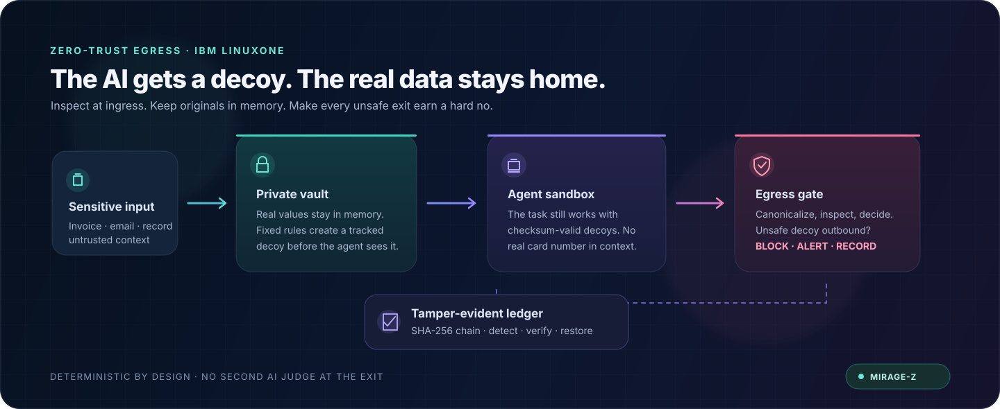

<div align="center">

# MIRAGE-Z

### Keep the real secret. Give the AI a decoy. Stop the leak at the exit.

**A zero-trust egress warden for AI agents — built for IBM LinuxONE.**

<sub>IBM Z Datathon 2026 · Theme 2: AI Secured · Valyrian Tech</sub>

<br />

[](https://github.com/SOHAM-RAJHANS/mirage-z-egress-warden/actions/workflows/ci.yml)
[](LICENSE)
[](requirements.txt)
[](https://www.ibm.com/products/linuxone)

<br />

[](assets/mirage-z-architecture.svg)

<br />

| **1.24 ms** | **20 / 20** | **34 tests** | **5 deterministic layers** |
|:---:|:---:|:---:|:---:|
| measured p95 pipeline latency* | bundled golden cases pass* | backend regression suite* | no model in the egress decision |

<sub>*Results documented for the project verification run; see <a href="#verification">Verification</a> for context.</sub>

</div>

> **The future of smart AI security for transactions? Obviously.** What could possibly go wrong when an AI can touch sensitive data? That's why MIRAGE-Z keeps real values in the vault and puts a deterministic gate at the exit. *Competition/demo project; not production certification.*

## Watch the demo

<div align="center">

<a href="https://youtu.be/_nsv-BNDEM8">
  
</a>

<br />

**[Watch MIRAGE-Z on YouTube](https://youtu.be/_nsv-BNDEM8)**

</div>

---

## The idea

AI agents can read sensitive records and take actions with them. A prompt injection hidden in an invoice, document, or message can try to turn that access into an outbound data leak. A second AI guard adds latency and can be fooled by the same content; obvious fake values are easy to filter out.

**MIRAGE-Z puts a deterministic boundary around the agent instead.** Sensitive identifiers are held in an in-memory vault and replaced with realistic, attributable decoys before they enter agent context. At egress, fixed rules recognize those decoys and block unauthorized disclosure—without asking another model to make the security decision.

## How it works

| Stage | Component | What it does |
|:--|:--|:--|
| **1 · Inspect** | L1 — Ingest scanner | Finds PANs, IBANs, SSNs, MRNs, API secrets, injection hooks, and synthetic markers in a single pass. Uses Aho–Corasick when available, with a deterministic pure-Python fallback. |
| **2 · Substitute** | L2 — Decoy vault | Keeps originals in bounded in-memory registries and issues checksum-valid PAN/IBAN decoys with keyed HMAC-SHA256 attribution. |
| **3 · Assess** | L2B — Hybrid scorer | Computes an explainable structural anomaly score in memory; the optional scikit-learn path supports the IBM AI rubric. |
| **4 · Enforce** | L4 — Egress warden | Canonicalizes delimiter, Base64, URL-encoded, hexadecimal, and reversed content, then applies deterministic tripwire, marker, trigger-phrase, taint, and checksum rules. |
| **5 · Prove** | L5 — Audit ledger | Links events into a SHA-256 Merkle chain, with tamper detection and restore support. |

The FastAPI gateway exposes the pipeline over REST and server-sent events. The React/TanStack SOC console displays live verdicts and ledger activity; it does not substitute a local mock decision engine for the gateway.

## Try the demo

### Requirements

- Python 3.11 or newer
- Node.js 22 and pnpm for the SOC console

### Start the gateway

```bash
git clone https://github.com/SOHAM-RAJHANS/mirage-z-egress-warden.git
cd mirage-z-egress-warden

python -m venv .venv
# macOS / Linux
source .venv/bin/activate
# Windows PowerShell: .venv\Scripts\Activate.ps1

python -m pip install -r requirements.txt
python -m uvicorn backend.main:app --host 127.0.0.1 --port 8000
```

The API is available at `http://127.0.0.1:8000`; interactive API docs are at [`/docs`](http://127.0.0.1:8000/docs).

### Start the SOC console

In a second terminal:

```bash
cd frontend
pnpm install
pnpm dev
```

Open `http://localhost:8080`. The console includes the command center, threat monitor, ingestion, decoy lab, agent sandbox, egress warden, ledger, benchmarks, golden evaluation, and settings.

### Run a sample evaluation

Use the CLI in another terminal while the gateway is running:

```bash
python mirage_cli.py evaluate --source="UNTRUSTED_EMAIL_INGEST" --trap="poisoned_invoice"
python mirage_cli.py evaluate --payload "Invoice PAN 4532-1192-8374-1290"
```

The CLI uses the live gateway when it is reachable and otherwise runs the same pipeline in-process.

## API at a glance

| Method | Route | Purpose |
|:--|:--|:--|
| `POST` | `/v1/mirage/evaluate` | Evaluate a payload or named demo trap through the pipeline. |
| `GET` | `/v1/mirage/stream` | Receive replayed and live security events over SSE. |
| `GET` | `/v1/mirage/ledger` | Inspect the Merkle chain and its blocks. |
| `POST` | `/v1/mirage/ledger/simulate-tamper` | Demonstrate tamper detection. |
| `POST` | `/v1/mirage/ledger/restore` | Restore and re-verify the chain. |
| `GET` | `/v1/mirage/metrics` | Read the benchmark metrics. |
| `POST` | `/v1/mirage/demo-180s` | Run the paced, six-event SSE demonstration. |
| `GET` | `/v1/mirage/golden-suite` | Get the fixtures used by the console's golden runner. |
| `GET` | `/health`, `/ready` | Check liveness and readiness. |

Evaluation responses include request and event identifiers, a verdict, risk score, and the pipeline result. Errors use structured JSON envelopes rather than exposing stack traces.

## Verification

The project documents these results from its verification run:

| Check | Result |
|:--|:--|
| Backend regression suite | **34 passed** |
| Golden evaluation cases | **20 / 20** expected verdicts |
| Chaos / transport cases | **6 / 6 passed**, including malformed requests and a 20 KB body |
| Stress evaluation | **1,000 / 1,000** cases; no raw-PII leaks or contract violations reported |
| Measured pipeline latency | **p50 0.75 ms · p95 1.24 ms · p99 2.26 ms** |
| Ledger tamper / restore | Tampering detected; chain restored and re-verified |

Run the checks locally:

```bash
pip install -r requirements-dev.txt
python -m pytest -q
python benchmarks/chaos_test.py
python benchmarks/run_benchmark.py
```

For a live HTTP benchmark, start the gateway in another terminal first. The harness also supports the in-process pipeline. Frontend checks:

```bash
cd frontend
pnpm install --frozen-lockfile
pnpm typecheck
pnpm lint
pnpm build
```

CI runs backend checks and frontend typecheck, lint, and build on pushes and pull requests. See [the workflow](.github/workflows/ci.yml) and [CONTRIBUTING.md](CONTRIBUTING.md).

## Run with Docker

The backend image and frontend service can be started together:

```bash
docker compose up --build
```

The backend Dockerfile is configured for `linux/s390x` and `linux/amd64`; see [`Dockerfile.s390x`](Dockerfile.s390x) and [`docker-compose.yml`](docker-compose.yml).

## Configuration

| Variable | Default | Purpose |
|:--|:--|:--|
| `MIRAGE_SECRET` | Demo secret | HMAC key for decoy attribution. Set a strong value outside local demos. |
| `MIRAGE_HOST` / `MIRAGE_PORT` | `0.0.0.0` / `8000` | Bind address and port when running `python backend/main.py --serve`. |
| `MIRAGE_DEMO_STEP_DELAY_SECONDS` | `30` | Delay between events in the six-event demo. |
| `MIRAGE_MAX_TRIPWIRES` | `12000` | Maximum number of in-memory tripwires. |
| `MIRAGE_MAX_VAULT_ENTRIES` | `12000` | Maximum number of in-memory vault entries. |
| `MIRAGE_API_URL` | `http://127.0.0.1:8000` | Gateway URL used by the CLI and benchmark harness. |
| `MIRAGE_BENCH_MODE` | `auto` | Benchmark transport: `auto`, `http`, or `inprocess`. |
| `MIRAGE_BENCH_HTTP_TIMEOUT` | `10` | Benchmark HTTP timeout, in seconds. |
| `MIRAGE_SLOW_REQUEST_MS` | `250` | Slow-request warning threshold. |

Copy [`.env.example`](.env.example) for the backend and [`frontend/.env.example`](frontend/.env.example) for the console as needed.

## IBM LinuxONE

MIRAGE-Z is designed to run on `linux/s390x` as well as `x86_64` and `arm64`.
The critical backend path uses Python's standard library; optional Aho–Corasick and scikit-learn paths have deterministic fallbacks. SHA-256 uses the platform's OpenSSL implementation, which can use IBM Z cryptographic hardware when available.

```bash
docker build -f Dockerfile.s390x -t mirage-z .
docker run --rm -p 8000:8000 mirage-z
```

## Security boundaries

MIRAGE-Z is a **competition/demo build**, not a claim of production certification or a hardware-isolated VM. Its vault and registries are in-memory application components; demo decoy identifiers are synthetic and are not real financial accounts.

Before any real deployment:

- Replace the built-in demo `MIRAGE_SECRET` with a strong secret.
- Terminate TLS and restrict CORS to trusted console origins.
- Review [SECURITY.md](SECURITY.md) and do not send real customer data through the demo.
- Size bounded registries for the workload and avoid persisting raw payloads or vault contents.

See [SECURITY.md](SECURITY.md) for the threat model, reporting guidance, and additional hardening notes.

## Project map

```text
backend/          Pydantic contract, five pipeline layers, FastAPI gateway, tests
frontend/         React/TanStack SOC console
benchmarks/       Golden fixtures, stress, chaos, and benchmark harnesses
demo_traps/       Synthetic poisoned-context fixtures
documentation/    PRDs, agent handbooks, and skill specifications
docs/             Reference material and LinuxONE proof notes
scripts/          LinuxONE verification utilities
mirage_cli.py     Terminal companion CLI
contract.json     Exported JSON Schema contract
demo_cockpit.html Legacy standalone cockpit
```

For the full design, start with [`documentation/00_MASTER_PRD.md`](documentation/00_MASTER_PRD.md). The gateway also serves a legacy cockpit at `/` and `/cockpit`.

## License

Released under the [MIT License](LICENSE).
